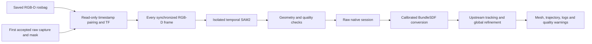

# Reconstruct a recorded RGB-D video

The BundleSDF panel can now prepare a whole saved scan recording, track its target
offline and reconstruct it. It uses the accepted first capture as the target seed,
then processes every available synchronized RGB-D pair after that seed. It no
longer needs a live SAM2 mask for every reconstruction frame or a MOVING event.
The robot's stationary captures, live recorder sampling, NBV and safety are unchanged.



## GUI

On the next normal GUI launch, open **Reconstruction Validation → BundleSDF results**:

1. Select the recording ending in `.closed` or `.incomplete`, or use **Browse…**.
2. Leave **Frame stride = 1** to use every usable prepared frame.
3. Use **Allow partial scan** for a cancelled scan or one without recorded completion.
4. Click **Reconstruct**. Extraction, temporal segmentation and reconstruction run
   outside Tk, with stage status, mask counts, written-pose progress and log paths displayed. Active missions block starting
   this GPU job. **Cancel reconstruction** signals only the job's process group.
5. On completion, click **Open BundleSDF Model** to inspect the interactive textured mesh.
   A mesh export is not an accuracy certificate; explicit tracking failures appear as warnings.

**Validate dataset** on an archive performs extraction, SAM2 preparation and native
validation, but does not run BundleSDF reconstruction. It therefore uses the
segmentation GPU environment. Validation on an already prepared native session
does not rerun segmentation. Closing the GUI leaves an already-started independent
job running; use Cancel first if it should stop. The existing mission GUI is never
restarted automatically to load these controls.

Results are under `~/.local/share/piper-bundlesdf/evidence/<unique-job>/`:
`result/textured_mesh.obj`, `material.mtl`, `material_0.png`, `result/ob_in_cam/`,
`bundlesdf.log`, `result_validation.json`, `validation.json`, `run.json` and provenance.
Prepared images and stage logs remain in the corresponding `runtime/jobs/<unique-job>/`.
Keep mesh, material and texture together. Native sessions remain selectable as before.

## Command line

Use fresh output paths; overwrite is refused:

```bash
python3 tools/bundlesdf/reconstruct_job.py \
  datasets/mission_recordings/scan_recording_EXAMPLE.closed \
  --job-dir "$HOME/.local/share/piper-bundlesdf/jobs/my-scan" \
  --output "$HOME/.local/share/piper-bundlesdf/evidence/my-scan" \
  --allow-incomplete --frame-stride 1
```

Individual stages, useful for inspecting masks before the expensive mesh run:

```bash
source piper_ros_foxy/install/setup.bash
python3 tools/bundlesdf/extract_video.py \
  datasets/mission_recordings/scan_recording_EXAMPLE.closed /tmp/my-video
tools/bundlesdf/python_sam2.sh tools/bundlesdf/segment_video.py \
  /tmp/my-video /tmp/my-prepared-session
python3 tools/bundlesdf/dataset.py /tmp/my-prepared-session --validate-only --allow-incomplete
python3 tools/bundlesdf/run.py /tmp/my-prepared-session --allow-incomplete \
  --output "$HOME/.local/share/piper-bundlesdf/evidence/my-scan"
```

Extraction reads existing rosbag2 SQLite files directly; no playback node, DDS
delivery, camera or robot driver is needed. The legacy `import_bag.py` remains a
diagnostic reproduction of the live filtered recorder and is not the dense route.
An ordinary RGB MP4 alone lacks the required aligned depth and calibration.

## Environments and provenance

BundleSDF uses the [existing isolated native installation](bundlesdf_native_runtime.md).
Temporal segmentation reuses
`AI_perception_tests/groundingdino_test/envs/grounded_sam2_py310/bin/python`,
the existing `Grounded-SAM-2` checkout with streaming methods, and
`checkpoints/sam2.1_hiera_tiny.pt`. Nothing is installed into Foxy. If the interpreter
is elsewhere, set `GROUNDED_SAM2_PYTHON`. The launcher clears ROS Python/library
paths. Missing CUDA, checkpoint or streaming API fails with an explicit error.
Do not substitute a CPU or fake predictor while describing the run as GPU SAM2.

Each prepared manifest stores model checkpoint SHA256, SAM2 repository commit,
predictor and memory-compactor hashes, configuration, source timestamps and rejection
counts. Model paths/configuration reuse the existing perception defaults. No weights,
bags or generated meshes belong in Git.

## Quality and limitations

Legacy archive recovery requires identical RGB/depth message timestamps and no depth
reuse. The recorded `synchronization_slop_sec` remains provenance, but does not authorize
approximate pairing here: unpatched RealSense 4.0.4 can mislabel unaligned depth.
An ambiguous accepted initial pin fails rather than seeding incorrect geometry. Camera
calibration must remain fixed; TF is looked up at the image stamp, never latest.
Every paired image updates SAM2 temporal state even if that frame's TF, angle,
mask envelope, depth or blur later prevents reconstruction admission. Predicted
masks are never relabelled as old ROS messages or reused without inference.

The live `sample_rate_hz` value remains in the saved configuration for provenance;
the prepared manifest's `acquisition_policy` explicitly states that offline sampling
uses every synchronized frame. Frame stride is applied only after propagation.
Quality gates retain the recorded thresholds. A missing initial accepted pin
fails rather than choosing a rectangular ROI or a different target estimate.

Inspect `extraction.json` for synchronization losses and `manifest.json` for quality
rejections. Inspect `result_validation.json/tracking_health` and `bundlesdf.log` for
upstream failures: a saved pose matrix can exist even when that frame failed tracking.
More frames improve continuity but cannot guarantee reconstruction accuracy, unseen
surface coverage or recover sensor frames absent from the bag. A closed archive
without a terminal workflow event remains an incomplete mission.

See [aligned-depth correction and validation](../experiments/aligned_depth_fix_validation.md)
for the camera publication guard and conservative recovery of existing recordings.
