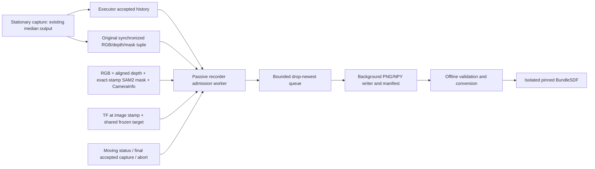

# Reconstruction-only RGB-D recording

cuRobo is the active mission planner (`config/planner_backend.yaml` selects `curobo`).
The optional recorder observes accepted mission captures and moving scan status. It
cannot command the arm, complete a viewpoint, change NBV scores, or increment the
mission capture count. The existing stationary median-depth output is retained.
The first semantically accepted capture freezes the executor's existing coverage
target and creates a session; its separately pinned raw, synchronized tuple is
frame zero. A missing or rejected initial tuple prevents moving-frame admission.



## Configuration and launch

Set `target_visibility_angle_tolerance_deg: 20.0` in
`piper_ros_foxy/src/piper_mobile_manipulation/config/scan_execution_params.yaml`.
The shared geometry module is the authoritative code default. Bridge, request
hash, Tesseract worker, cuRobo worker, MotionPlan binding, executor, and recorder
carry the same configured value. Angles must be finite and strictly between zero
and 90 degrees. Optical forward is +Z; the boundary is inclusive with a 1e-6 degree
floating-point allowance. Behind-camera and invalid vectors fail closed.

For compatibility, motion retains the **existing** widened final-aim exception:
its effective cone is `max(target_visibility_angle_tolerance_deg,
final_capture_aim_tolerance_deg)`. Initial alignment also retains its existing
non-worsening recovery policy. The recorder does not inherit these exceptions.
The existing final-aim default is five degrees and first-capture aim remains capped
at five. Selecting a movement cone below a larger final-aim setting is therefore
not a hard movement cap. No collision, distance, authorization, or freshness gates
were removed. The deprecated `scan_target_max_boresight_deg` non-default override
is rejected with migration guidance.

All consumers freeze configuration at startup. Change YAML or launch overrides
and relaunch the scan stack **between missions**. Live `ros2 param set` for this
setting is rejected explicitly; there is no unsafe partial update. Standalone
nodes accept `--ros-args -p target_visibility_angle_tolerance_deg:=10.0`, but launch
is preferred so every consumer receives the same value. Rebuild and restart all
ROS consumers after the additive MotionPlan message change.

```bash
cd /home/prl/Piper_arm
source /opt/ros/foxy/setup.bash
cd piper_ros_foxy
colcon build --symlink-install
source install/setup.bash
PIPER_PLANNER_BACKEND=curobo ros2 launch piper_mobile_manipulation supervised_viewpoint_execution.launch.py \
  reconstruction_recording_enabled:=true \
  target_visibility_angle_tolerance_deg:=20.0 \
  reconstruction_output_root:=/home/prl/Piper_arm/datasets/reconstruction_sessions
```

Use the existing mission approval/start procedure after launching. Enabling the
recorder does not authorize motion. YAML recorder defaults live in
`config/reconstruction_recording_params.yaml`; quality area and margin are taken
from the existing `scan_quality_params.yaml` by the launch file.

| Parameter | Default | Meaning |
|---|---:|---|
| reconstruction_recording_enabled | false | Launch recorder and raw keyframe publisher |
| target_visibility_angle_tolerance_deg | 20.0 | Shared movement/acceptance configuration |
| recorder_visibility_angle_tolerance_deg | 0.0 | Inherit; positive value may only tighten |
| sample_rate_hz | 8.0 | Moving admission rate, permitted 5–10 Hz |
| synchronization_slop_sec | 0.08 | Maximum RGB/depth delta, permitted (0, 0.1] s |
| max_mask_age_sec | 1.0 | Maximum moving mask receipt age |
| min_mask_area_px | 100 | Existing quality minimum |
| edge_margin_px | 40 | Existing quality margin; touching boundary rejected |
| minimum_valid_depth_ratio | 0.50 | Positive finite target-depth fraction |
| blur_gate_enabled | true | Enable target-interior Laplacian gate |
| minimum_blur_score | 20.0 | Needs camera/object-specific calibration |
| max_mask_area_growth_ratio | 2.0 | Maximum perspective-normalized area versus initial mask |
| writer_queue_size | 8 | Maximum pending writes; drop newest |
| input_queue_size | 8 | Maximum pending sensor events, permitted 1–64 |
| depth_scale_m | 0.001 | Metres per 16UC1 unit; 32FC1 is always metres |
| output_root | /home/prl/Piper_arm/datasets/reconstruction_sessions | Standalone node destination; launch argument is reconstruction_output_root |
| base_frame | base_link | Transform target/world frame |
| camera_optical_frame | camera_color_optical_frame | Transform source frame |
| task_id | empty | Must match selected task's raw keyframes; mission launch supplies it |
| color_image_topic | /camera/color/image_raw | RGB source |
| depth_image_topic | /camera/aligned_depth_to_color/image_raw | Depth aligned to RGB |
| camera_info_topic | /camera/color/camera_info | Matching calibration |
| mask_topic | /piper/sam2_target_mask | Exact-stamp tracked target mask |

The ROS synchronizer uses a 100 ms diagnostic pairing window; the stricter
configured delta is enforced in admission. Completely unmatched sensor messages
outside that window never become candidates. Masks must match the RGB timestamp;
there is no rectangular ROI fallback. A pinned stationary tuple was selected fresh
by the existing capture path; semantic acceptance delay is not treated as sensor
age. Task identity, exact timestamps and all remaining gates still apply.

## Native session contract

Each UUID-named `.inprogress` directory journals a manifest after each committed
frame. Normal completion follows the final accepted capture and atomically renames
the directory to `.complete`; abort, failure, or shutdown stays explicitly
incomplete (`.failed`, `.cancelled`, or `.incomplete`). A hard kill can leave a valid
journal in `.inprogress`. Validation detects orphaned/partially written files.
Repeated missions create separate sessions. Queues are bounded, drop newest, and
never wait on motion execution. ROS callbacks queue references; separate admission
and writer threads perform decoding/TF and encoding/disk work respectively.

RGB and binary masks are lossless PNG. Depth is lossless NPY preserving original
16UC1 or 32FC1 precision. Per-frame JSON and the manifest record integer nanosecond
stamps, actual synchronization delta, calibration, encoding/scale, target identity,
angle, mask bounds/margin, blur, valid depth fraction, source and accepted viewpoint.
`T_base_camera` maps optical camera coordinates into base coordinates:
`p_base = R_base_camera * p_camera + t_base_camera`. It is **not** an object pose.
No latest-TF fallback exists. Rotation, translation and homogeneous row are checked.
CameraInfo changes, distortion, mismatched dimensions or stream identity reject.
Non-finite target depth rejects; non-finite depth outside the mask is retained in
the native file and converted to zero for BundleSDF. Moving sample timing uses
image timestamps; duplicates/out-of-order candidates reject.

Inspect `/piper/reconstruction_recording_status` and the manifest's accepted,
rejected-by-reason, and dropped totals. Sources are `first_capture`, `moving`,
`stationary_capture`, and `final_capture`. A one-view session keeps frame zero as
`first_capture`. A completed mission can still produce an unusable dataset when
too few frames pass; offline validation requires five frames by default.

## Offline validation, conversion and reconstruction

```bash
cd /home/prl/Piper_arm
SESSION=/absolute/path/to/a/session.complete
python3 tools/bundlesdf/dataset.py "$SESSION" --validate-only
python3 tools/bundlesdf/dataset.py "$SESSION" --output /tmp/bundlesdf-input \
  --frame-stride 1 --start-frame 0
# Add --allow-incomplete to inspect/convert a valid partial journal.
# --end-frame is exclusive. Existing output directories are always refused.
```

The adapter follows pinned `BundleTrack/scripts/data_reader.py::YcbineoatReader`:
`rgb/*.png`, `depth/*.png` uint16 millimetres, `masks/*.png`, and `cam_K.txt`.
Float depth is quantized to the nearest millimetre (at most 0.5 mm error), and values
outside uint16 range reject. Robot camera poses remain in an explicitly labelled
diagnostic sidecar, never in upstream `annotated_poses`. Paths containing `rgb` in
the output's parent are refused because upstream replaces that substring globally.
MP4-only inputs are rejected: depth, calibration, masks and transforms are missing.

BundleSDF is pinned to **ffa67d425240b5b76d2e387a7dd3d3735a7cf1a1** at
<https://github.com/NVlabs/BundleSDF>. Read its pinned `LICENSE.txt`: the NVIDIA
license restricts use to noncommercial research/evaluation. Upstream is cloned
outside ROS; its implementation, weights and generated artifacts are not vendored.
Install Docker and NVIDIA Container Toolkit separately, then:

```bash
bash tools/bundlesdf/setup.sh
# Download LoFTR outdoor_ds.ckpt using the pinned upstream README instructions
# into ~/.local/share/piper-bundlesdf/upstream/BundleTrack/LoFTR/weights/.
# First verify upstream's supplied milk dataset inside this image:
UPSTREAM="$HOME/.local/share/piper-bundlesdf/upstream"
PIN=ffa67d425240b5b76d2e387a7dd3d3735a7cf1a1
# Place the official downloaded/extracted example at /tmp/bundlesdf-milk.
# Choose an entirely NEW output path: upstream removes its output directory.
docker run --rm --gpus all -v "$UPSTREAM:$UPSTREAM" \
  -v /tmp/bundlesdf-milk:/data/milk:ro -v /tmp:/outputs -w "$UPSTREAM" \
  "piper-bundlesdf:$PIN" python3 run_custom.py --mode run_video \
  --video_dir /data/milk --out_folder /outputs/bundlesdf-official-smoke \
  --use_segmenter 0 --use_gui 0 --debug_level 2
python3 tools/bundlesdf/run.py "$SESSION" --output /tmp/bundlesdf-run
```

The wrapper also accepts `--upstream`, a separately installed environment's
`--python`, `--validate-only`, `--allow-incomplete`, and frame selection arguments.
It preserves validation, exact command/pin/configuration and logs, checks subprocess
success, then verifies `result/textured_mesh.obj` has vertices/faces and
`result/ob_in_cam/*.txt` contains the estimated trajectory. Missing Docker, weights,
CUDA or native extensions fail with an actionable error. An exit without a mesh is
not reported as success. Setup builds native extensions in the external checkout
and commits their Python installation metadata into the isolated image.

Optional CPU-only loader compatibility check (requires imageio, numpy and OpenCV
in a separate tooling environment):

```bash
python3 tools/bundlesdf/check_upstream_loader.py /tmp/bundlesdf-input --upstream "$UPSTREAM"
```

## Replay and diagnostics

```bash
source /opt/ros/foxy/setup.bash
source piper_ros_foxy/install/setup.bash
ROS_DOMAIN_ID=173 ROS_LOCALHOST_ONLY=1 python3 tools/bundlesdf/replay.py \
  --output /tmp/reconstruction-replay-new
ROS_DOMAIN_ID=175 ROS_LOCALHOST_ONLY=1 PIPER_REPLAY_TASK_ID=recorded-task-id \
  PIPER_REPLAY_VISIBILITY_DEG=20.0 bash tools/bundlesdf/replay_bag.sh \
  /path/to/compatible-bag /tmp/reconstruction-bag-new
```

The bag wrapper checks required sensor, TF, raw keyframe, accepted history, execution
and workflow topics. It plays only these topics; no arm commands or mission process
are launched. Task identity and selected angle must match the recorded mission.
Foxy does not provide `ros2 bag play --clock`; admission uses original message
stamps and TF, while scheduling/shutdown uses monotonic time. Validate and convert
the resulting session using the same commands above. Legacy bags without raw
keyframes and accepted identity are rejected explicitly.

| Symptom | Action |
|---|---|
| No accepted frames | Confirm first accepted history, matching task ID and raw keyframe; inspect manifest reasons |
| target_clipped | Keep full target farther from the shared image margin |
| missing_mask / stale_mask | Check SAM2 target selection, exact stamp and delivery age; never substitute ROI |
| rgb_depth_unsynchronised | Check aligned topics and measured delta; pairs beyond 100 ms do not enter candidate counters |
| missing_tf / invalid_tf | Ensure base-to-optical TF history covers image timestamps; no latest fallback |
| invalid_intrinsics | Verify resolution, RGB calibration, frame IDs and undistorted stream |
| excessive_blur | Run `python3 tools/bundlesdf/blur_diagnostic.py RGB.png MASK.png`; calibrate using sharp/blurred target samples |
| writer_queue_full / input_queue_full | Use faster storage or lower 5–10 Hz recording rate; drops do not pause motion |
| CUDA/extensions/weights failure | Inspect bundlesdf.log/failure.json; repair the isolated image, not Foxy Python |

See [executed validation](../experiments/reconstruction_recording_validation.md)
for measured evidence and blocked tests. No physical arm/camera qualification or
successful BundleSDF mesh reconstruction is claimed by this implementation record.
