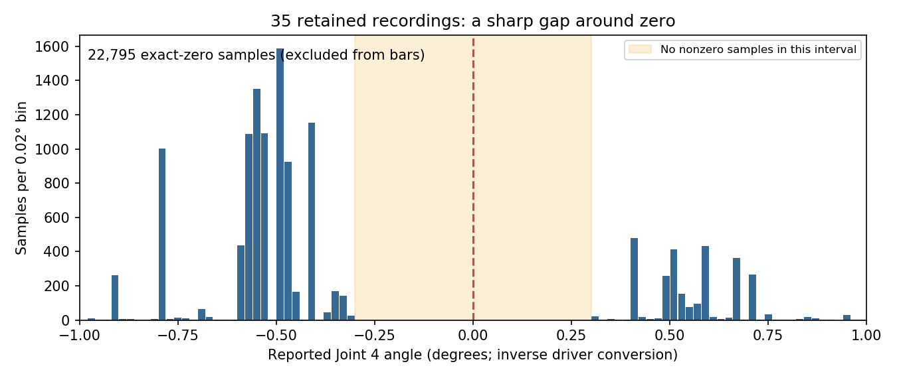

# Joint 4 startup blockage — 10 September 2026

## Scope and evidence
Passive SocketCAN capture only; no SDK interface connection, arm commands, driver launch, reset, enable, zeroing, or parameter writes. Raw capture: passive_can.json; aggregate: summary.json.

20.000 seconds of bus traffic: 3999 joint-3/4 frames at approximately 200 Hz. Joint 3 remains 979 millidegrees. Joint 4 reports -375 millidegrees 3790 times and zero 209 times, with 268 transitions. Payloads are `000003d3fffffe89` and `000003d300000000` on 0x2A6. Decoding all 3999 frames with the installed vendor C_PiperParserV2 agrees with independent signed big-endian decoding with zero mismatches.

Controller-computed end-pose frames also change between two payload sets: each 0x2A2/0x2A3/0x2A4 has 209 alternate reports. Thus the change is visible in the controller's own Cartesian reporting, not just our ROS conversion. This does not establish physical motion or prove which internal sensor/conversion produced the change.

Only periodic feedback IDs are present; no command IDs. All six 0x261–0x266 motor status bytes are zero: disabled, no reported fault flags. J4 supply 23.0 V, driver 34 C, motor 28 C. Host CAN bus-error and bus-off counters were zero when inspected; historical RX drops were nonzero and cannot be claimed absent. Missing packets cannot manufacture the two payloads actually received.

The 0x254 motor position is always zero but is documented as an integer in radians, so this is not sufficiently resolved independent position evidence. Speed ranges -0.120 to +0.103 rad/s as encoded. Do not claim motor-position zero proves physical immobility.

## Software consequence
Using the actual driver raw decoder and actual joint_stability_update implementation, this capture restarts the stability window 269 times including initialization; longest interval is 0.860 seconds. J4 step is 0.0065415 rad under the existing conversion, exceeding the 0.005 rad settling window. Startup requires 2 seconds within a 15-second timeout before launching camera or either planner. Latest failed runs terminate at this gate; neither Tesseract search nor camera tracking runs.

The stability helper is unchanged since commit d738a78 on 2026-08-01. Driver, joint-state policy, startup gates and mission-node source have no local changes. Every new mission clears prior joint observations/window state before starting its driver. There is no retained software latch explaining repeated retries; the raw input pattern independently recreates the failure.

## Diagnosis and limit
Confirmed: controller-originated two-level Joint 4 feedback causes a deterministic startup settling timeout. The controller also reflects the changed value in its Cartesian pose output. This is not SDK decoding, ROS/DDS mixing, a planner loop, or a commanded servo oscillation from our stopped driver.

Unresolved: internal encoder quantization/noise, firmware rounding/zero handling, or small unpowered mechanical motion. Passive bus data contains no independent high-resolution physical position measurement to separate those. No evidence supports claiming a known firmware fix, defective motor, or controller reset as a proven remedy. SDK documentation confirms wire units but does not explain this exact alternating pattern.

Next discriminating experiment requires an independently observed or explicitly controlled near-zero/off-zero J4 comparison while recording the same raw streams. A power/reset comparison alone can show state dependence but does not establish hardware versus firmware. No such physical experiment was performed. Do not globally round feedback, discard legitimate zero positions, or relax safety thresholds based solely on this capture.

Official encoding reference: https://github.com/agilexrobotics/piper_sdk/blob/master/asserts/V2/INTERFACE_V2.MD

## Independent inertial follow-up
The user authorized continued diagnosis. A temporary RealSense ROS session was started on isolated domain 188; no arm driver or motion authority was started. The physical L515 f1120648 provided 3002 gyro samples at about 100 Hz and 6041 accelerometer samples at about 200 Hz over 30 seconds, concurrently with 5992 raw Joint 3/4 CAN frames. Raw evidence is imu_can.json, aggregates imu_summary.json, sensor launch output imu_camera.log, collection script record_imu_can.py.

CAN Joint 4 changed 192 times between -0.375 degrees and zero. Median interval between the old and new sample was 0.005000827 seconds, implying approximately 1.31 rad/s if interpreted as actual link rotation across that interval. The wrist-mounted camera gyro's maximum vector magnitude across the complete interval was only 0.0106164 rad/s (including bias). Gyro axis standard deviations were [0.000514, 0.001790, 0.000389] rad/s. Accelerometer standard deviations were [0.01049, 0.01210, 0.01297] m/s^2; maximum vector deviation from its mean was 0.05994 m/s^2.

This independent inertial evidence strongly contradicts repeated physical 0.375-degree oscillations at the reported timescale, and supports controller/encoder reporting discontinuity with our settle gate treating it as movement. It does not rule out much smaller physical motion crossing an internal quantization boundary. No rigorous synchronized high-speed metrology claim is made: gyro sampling is 100 Hz versus CAN 200 Hz, receipt times provide overlap, and the RealSense driver warned that IMU calibration was unavailable and defaults were used. The discrepancy is about two orders of magnitude, well beyond an assertion based only on the coarse motor-position field.

Remaining unknown is internal firmware/encoder origin and whether this behavior occurs away from zero or when enabled. No resets, zero changes, enable requests, joint targets, or stability-threshold changes were made. The diagnostic camera session was then closed. A production workaround is not qualified by this single stationary test; raw feedback must remain honest and a narrow startup estimator would need independent drift/fault and powered-start qualification.

## Historical onset and upstream checks
Two prior cuRobo recordings were decoded from link3->link4 TF using the URDF joint origin and inverse driver unit conversion (previous_runs_j4.json). After the 23:57:19.751 disable request, Joint 4 first changed from zero to -0.366 degrees at 23:57:19.818, about 67 ms later. After the 00:03:16.773 disable request, it changed to -0.375 degrees at 00:03:16.859, about 86 ms later. These reports occurred during the per-axis disable transition. Both preceding powered home intervals reported stable zero after their normal arrival transient. This independently ties the observed pattern to entering the disabled home state, preceding the later Tesseract startup refusals. It does not establish which firmware branch is responsible.

Read-only protocol queries confirmed arm firmware S-V1.5-8 (firmware build string includes 250221), hardware H-V1.2-1. Gripper teaching parameters reply 0x47E `6446010000000000`: teaching range 100%, maximum range 70, friction/assistance 1. No parameter writes were made. Raw replies: controller_queries.json.

Upstream issue 33 documents faulty feedback on S-V1.5-8 with assistance 255 and recommends value 1; this arm already reports 1, so that proposed cause is unsupported here. Issue 67 documents actual powered MIT-mode twitching and a maintainer-confirmed firmware correction in 1.7-6+, alongside disputed SDK ThreadSafeBus reports. Our fault persists disabled without commands and has no matching physical inertial oscillation, so this is not evidence that 1.7-6 fixes our defect. Issue 101 reports all-zero states with no incoming CAN frames; our 200 Hz valid changing frames exclude that case. No verified upstream fix for this exact disabled J4 -0.375/0 discontinuity was found.

Sources: https://github.com/agilexrobotics/piper_sdk/issues/33 ; https://github.com/agilexrobotics/piper_sdk/issues/67 ; https://github.com/agilexrobotics/piper_sdk/issues/101 .

## Implemented pre-enable qualification
`startup_gates.PreEnableJointStability` is consumed only by the mission's two disabled startup waits through its joint callback. Original raw messages, telemetry, transforms, planner starts, strict joint stability and independent post-enable sample/stability checks are unchanged. The helper retains the 0.005-rad baseline drift rule. It defers only exact-zero Joint 4 reports from an anchor in [-0.008,-0.005) rad with a preceding J4 sample in [-0.008,0] rad and all other joints within the existing drift bound. A deferred sample never authorizes enable. An excursion lasting over 50 ms or representing over 10% of samples in the rolling two-second history resets proof. Gaps over 50 ms, invalid/out-of-order input, driver generations, stale motor status, enabled motors or faults invalidate this disabled proof. Sustained changes can qualify only after a new two-second settled interval.

Recorded replay: the failing 20-second trace never passed the old check, and passed the new one at 2.200 s. In the separate 30-second trace the old check intermittently succeeded at 2.264 s, versus 2.044 s for the new check; this is not a claim that every old attempt fails. A supervised powered startup remains required; a replay does not qualify physical operation.

## Validation and activation
- 1107 mobile/driver behavioral tests passed, one skipped. This includes raw-telemetry callback preservation and invalid-source reset, cancellation/startup sequencing, sustained drift, other-axis spikes, excessive zero duty cycle, long zero excursions, gaps and fault/enable status cases.
- Changed-file flake8 passes with the project 99-column limit; package build, all AI YAML parsing and git diff whitespace check pass. A combined invocation including the unrelated driver's multiprocess flake8 stalled; it was stopped and behavioral checks plus separate single-process changed-file lint completed.
- Isolated-domain, auto_enable=false real-driver smoke: 2105 joint messages, 2082 reporting J4=-0.0065415 rad and 23 reporting zero. The actual mission callback preserved raw telemetry byte values and qualified the disabled startup proof about 2.001 seconds after its first joint message. End-of-test status proved all motors disabled and healthy. No enable or movement service was called. Diagnostic driver stopped afterward.
- The idle mission coordinator was replaced with the same launch configuration after confirming all persisted goals/statuses had terminal results and no arm driver remained. Its normal SIGINT shutdown did not finish, so the idle coordinator and launch were terminated with SIGTERM before starting the singleton replacement. No mission was submitted. The next user-started mission loads the installed correction; a powered startup/scan is still pending qualification.

## Earlier occurrence confirmed
A further audit found the same zero/nonzero/zero pattern on 8 September at 23:56:25.532 UK: J4 briefly reported -0.309 degrees between zero reports. The retained driver log records disable requested at 23:56:25.450 and J4 disabled by 23:56:25.507, placing the negative report about 82 ms after disable began. Evidence: scan_recording_b2fdc8f2d8834b16b38e22c31a18f552.closed and driver.log around timestamp 1788908185. An additional pulse of -0.473 degrees occurs on 9 September at 23:17:01.769 UK in scan_recording_278f4cc77b9d4125a86350c9bd6e72f0.closed. The archive audit is selective, not an exhaustive first-occurrence search; see /tmp/piper_joint4_diagnosis_20260910/historical_zero_pulse_audit.json. Historical TF proves the reported pattern existed earlier, not independent physical immobility for those older instants. The startup patch mitigates the reporting pattern; it does not repair or establish the internal controller/encoder cause.

## Full retained-history audit and likely reporting cutoff
Read-only audit of all 35 closed recording folders (all SQLite shards) recovered 179,849 Joint 4 TF samples. The origin is Rx-only, so the joint angle is recovered with 2*atan2(qz,qw), wrapped to [-pi,pi], then inverse-converted through the existing 0.017444/1000 driver factor. Counts are reported in original nominal millidegrees, not a corrected calibration. There were 22,795 exact-zero samples, 12,365 nonzero samples inside +/-1 degree, and **no nonzero samples smaller than 0.302 degree in magnitude**. This is a strong empirical signature of near-zero suppression/deadband around +/-0.3 degree. No manufacturer documentation or firmware source was found confirming the exact boundary or algorithm, so it remains an inference. A controlled independent sweep would establish the transfer curve; it was not performed.

The detector found 21 isolated zero/nonzero/zero pulses of 0.287–0.8 degree in 11 recording folders, including positive pulses. Earliest retained example: **7 September 2026, 14:27:22.169 UK**, -0.321 degree, recording scan_recording_f62ed65bbeb4459cb35a9b36e64869f9.closed. The archive topic rate is lower than raw CAN and spans historical driver versions; pulse counts are not a physical-motion verdict or a complete count of all raw spikes. Some pulses occur outside the previously identified disable instant, so the problem must not be described as exclusively caused by disabling. Disabling commonly exposes it around the parked zero pose.

The likely mechanism is small underlying sensor/position variation crossing a zero-reporting cutoff, producing a discontinuous reported angle that exceeds our original 0.005-rad (~0.286 degree) settling threshold. This explains the seemingly disproportionate jumps and intermittent startup. It does not establish whether the cutoff acts on an encoder, a controller estimate, or a firmware status-dependent transformation. Current raw CAN confirms the alternating payload originates upstream of the SDK; the independent IMU evidence contradicts full-size physical oscillation.

This strengthens the reporting-boundary diagnosis but does not turn the startup mitigation into a firmware fix. The implemented exception remains intentionally limited to the current observed negative J4 pattern while disabled; it does not claim to handle every historical positive pulse or powered case.
